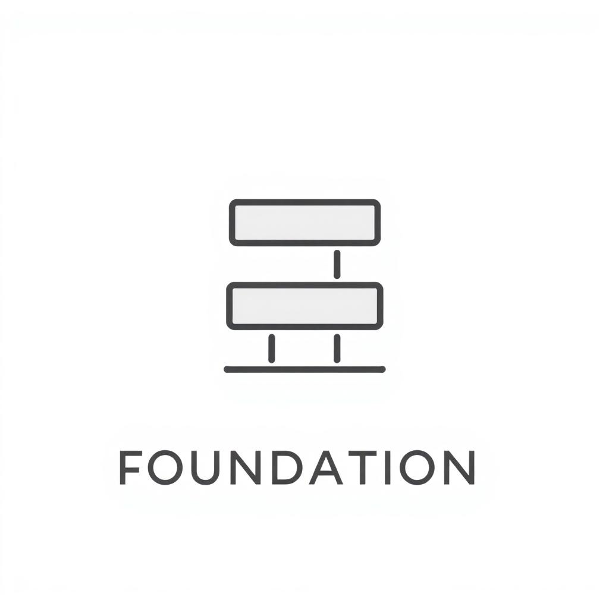

# Groundwork

<p align="center">
  
</p>

**The foundation that helps small businesses operate and grow.**

Groundwork gives independent businesses the operational capabilities large
companies have — without enterprise budgets. Free at its core, local-first by
default, and built so the people who run a business own their software and
their data.

`groundwork` is the repository codename. The first application built on the
foundation is **VetCare** (`apps/clinic`): local-first management software for
veterinary clinics. New industry applications share this foundation as real
use cases justify it — not before (see docs below).

## Principles

- **Free by default.** Starting a business on this software requires no
  subscription.
- **Own your data.** Local-first where practical; access, export, back up and
  keep data without depending on anyone's cloud.
- **Modular, not monolithic.** Inventory, reporting, staff management and
  industry workflows are added as separate applications, not one generic ERP.
- **Enterprise quality, small-business simplicity.** Reliable, secure,
  polished — without enterprise complexity.
- **Pay for convenience, not permission.** Managed hosting, cloud sync,
  automated backup and premium support are paid services; data portability,
  security updates and basic reliability never are.
- **Built for real operators.** Designed for the receptionist, cashier and
  owner who use the software every day.

Agents (and humans) working in this repo: read [`AGENT.md`](AGENT.md) first —
it sets the code, structure, and workflow standard and links the canonical
sources (`CONTEXT.md`, `.agents/skills/`, `docs/decisions/`).

## Layout

| Path | Purpose |
|---|---|
| `apps/clinic` | VetCare — Tauri 2 + React app (the desktop UI) |
| `apps/landing` | Public download page for the desktop binaries (React + Vite, EN/ไทย) |
| `apps/sidecar/` | Go sidecar `clinic-core`: local SQLite + sync engine |
| `server/` | Go API module: cloud API (Fiber + Postgres) for optional sync, plus the offline-MVP REST backend `server/cmd/vetcare` (`server/internal/offlineapi/` — normalized SQLite + sqlc, not yet wired into the shell) |
| `docs/` | Architecture, data model, ADRs, plans |
| `docs/assets/groundwork-mark.jpeg` | Foundation mark (concept) |

## Prerequisites

- Node 20+ and pnpm (JS package manager — used inside `apps/clinic` and `apps/landing`)
- Go 1.27+
- Rust stable (Tauri 2 prerequisites: webkit2gtk on Linux)
- GNU make — the task runner across all languages

## Commands

`make` is the entrypoint for everything that crosses language boundaries;
`make help` prints the current list. Each JS app owns its own tooling
(package.json, lockfile, node_modules) — the repo root has no JS.

```bash
make install       # pnpm install (all JS deps, clinic + landing)
make help          # list every target

make dev           # Vite dev server (browser, localStorage)
make dev-landing   # download page dev server (port 1421)
make tauri         # desktop shell (builds the sidecar first, then SQLite)
make build         # web build (clinic + landing)

make sidecar    # build + stage the Go sidecar binary (incremental)
make api        # build the offline REST backend (server/cmd/vetcare)

make lint       # every linter (TS + Go + Rust)
make lint-ts    # oxlint + knip (unused files, deps, exports)
make lint-go    # server: go vet + golangci-lint + gofmt check
make lint-rust  # Tauri shell: cargo fmt --check + clippy -D warnings
make fmt        # format everything (fmt-go, fmt-rust)
make vuln-go    # govulncheck (known Go CVEs reachable from code)

make test       # TS + Go + Rust tests (builds the sidecar first)
make test-ts    # vitest (unit + component + screenshot)
make test-go    # go test -race in every Go module (sidecar + cloud server)
make test-rust  # cargo tests for the Tauri shell
make test-pages # Playwright page tests
make ci         # exactly what the CI workflow runs
```

## Languages (English / Thai)

The UI ships in English (`en`, source) and Thai (`th`) via
[Lingui](https://lingui.dev). Strings live in the components as
`<Trans>…</Trans>` / `t` macros; catalogs are PO files under
`apps/clinic/src/locales/{en,th}/messages.po`. English renders from the
source strings; the Thai catalog is lazy-loaded on first use. The language
toggle is in the top bar and the choice persists per device (`vet.locale`,
defaults to the OS language).

```bash
make i18n-extract    # sync catalogs with source (new strings appear in both PO files)
make i18n-compile    # validate ICU syntax of the catalogs (strict)
```

Workflow for new UI strings: write the English source string inside a
`Trans`/`t` macro, run `i18n:extract`, then fill `msgstr` in
`src/locales/th/messages.po`. Untranslated Thai entries fall back to English.

## Cloud sync

The sidecar stays quiet unless configured:

```bash
export VET_CLOUD_URL=http://localhost:8080
export VET_DEVICE_TOKEN=<bearer JWT from /api/v1/auth/login>
```

It pushes pending outbox entries and pulls newer entities on every local
commit (debounced) and every 60 s. Without `VET_CLOUD_URL` the app is purely
local. See `docs/plans/2026-10-25-cloud-sync-architecture.md`.

## Where local data is stored

Desktop: OS app-data dir + `clinic.db`, e.g. on Windows
`%APPDATA%/com.vetclinic.desktop/clinic.db`. Visible in-app under
Settings → Database. Backup/restore arrives in Phase 3.

## Decisions

See `docs/decisions/` (ADRs), `docs/architecture.md`, `docs/data-model.md`.

The prioritized path to a pilot release is tracked in
[`docs/RELEASE-READINESS.md`](docs/RELEASE-READINESS.md).

## License

[MIT](LICENSE) — free to use, modify and build on.
